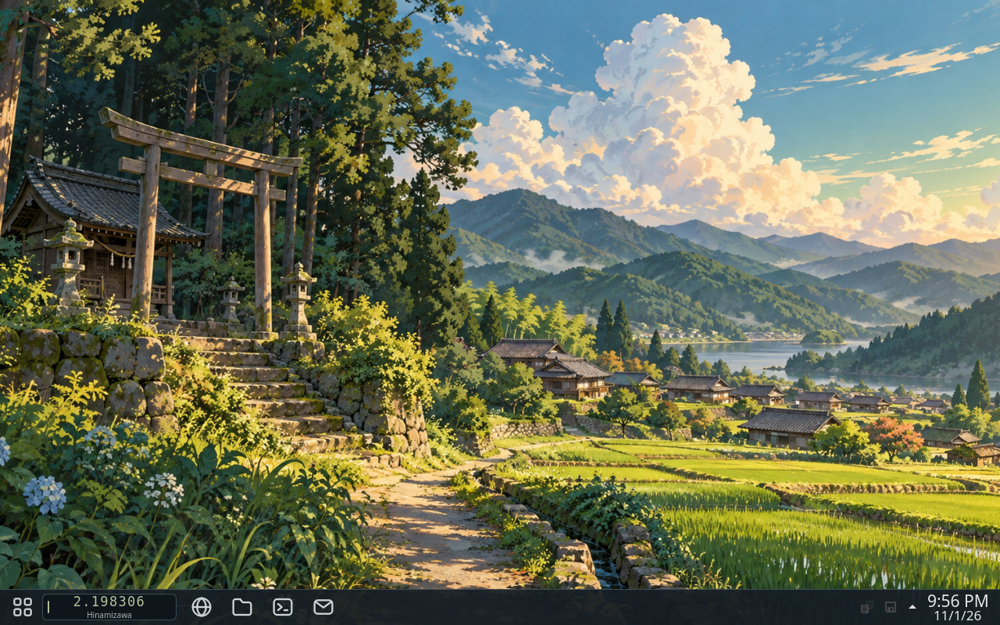
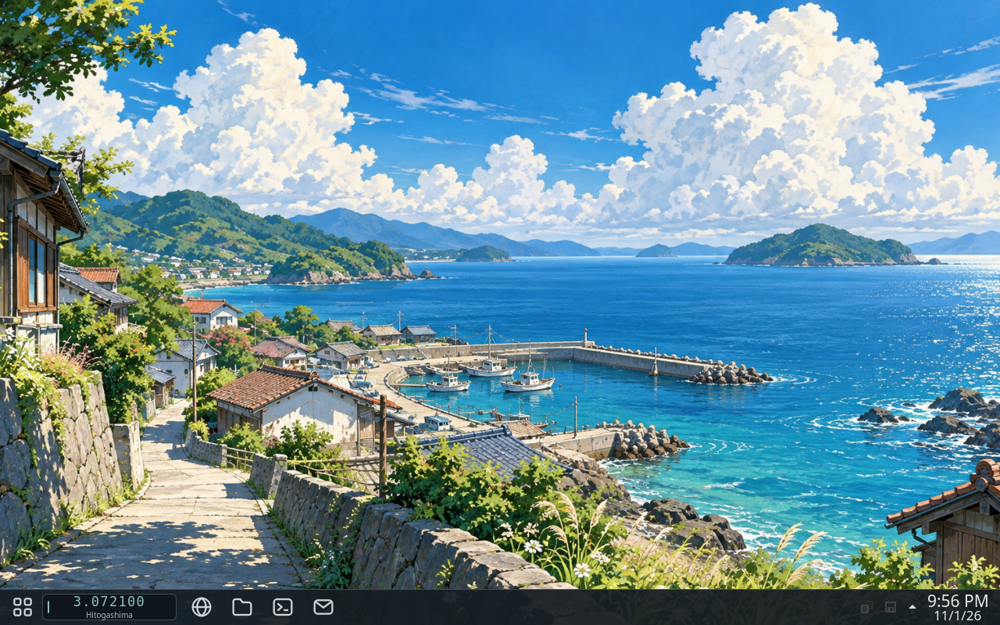
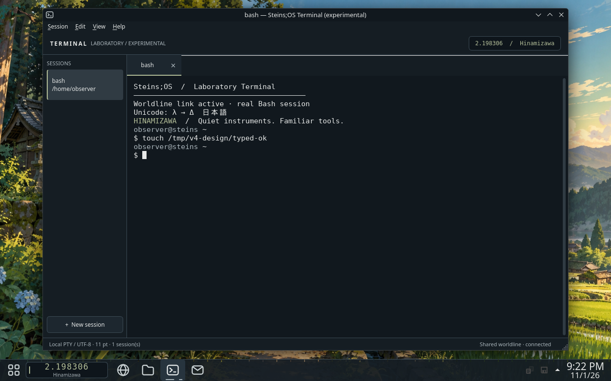

<p align="center">
  
</p>

<h1 align="center">Steins;OS</h1>
<p align="center"><strong>A Linux desktop from the Future Gadget Laboratory.</strong><br>Graphite surfaces. Quiet signals. Six worldlines. A real Debian foundation.</p>
<p align="center">
  <a href="#the-desktop">Desktop</a> ·
  <a href="docs/PROJECT-STATUS.md">Project status</a> ·
  <a href="docs/BUILDING.md">Build from source</a> ·
  <a href="docs/RELEASE.md">Release checklist</a>
</p>



*Actual V4 installed-system VM capture, 1280 × 800. The screenshot shows the Plasma prototype; the existing installable ISO uses XFCE.*

Steins;OS is an independent, fan-inspired Linux distribution project built on **Debian 13**. It combines a practical desktop with the atmosphere of retro terminals, laboratory instruments and branching timelines. The kernel, package manager, installer and desktop foundations come from maintained upstream projects; Steins;OS supplies its own identity and worldline experience.

> **Development preview.** A bootable XFCE ISO has passed live-boot and installation tests. The newer V4 Plasma desktop is implemented and tested in a separate installed-system VM. **A Plasma/V4 ISO has not yet been built and install-tested.** See [project status](docs/PROJECT-STATUS.md) before choosing what to build or test.

## The desktop

- **A deliberate visual language.** Restrained graphite surfaces, readable typography and warm instrument accents, with original artwork instead of redistributed anime images.
- **Six worldlines.** One persistent divergence value selects Alpha, Steins Gate, Hinamizawa, Hitogashima, Lugunica or Mitakihara. Wallpaper and atmosphere change together while application meanings stay familiar.
- **A signature divergence instrument.** V4 puts a clickable worldline meter into a slim native Plasma panel, alongside ordinary tasks, tray, calendar and launcher.
- **A coherent icon family.** 35 original icons share one geometry, with familiar folders, terminals and envelopes; upstream icons fill the rest of the desktop.
- **A real terminal.** The V4 frontend uses Debian's maintained QTermWidget engine with real shell sessions, tabs and coordinated chrome. Konsole remains available.
- **D-Mail, with clear boundaries.** The prototype offers a dedicated launcher and optional original Thunderbird theme for real email. The terminal `dmail` command is a separate fictional divergence tool; it sends nothing over the network.
- **An ordinary Linux foundation.** APT, systemd and Debian repositories remain in charge. Calamares handles installation of the XFCE image.

| Hitogashima · sea-glass atmosphere | Native terminal · real shell sessions |
| --- | --- |
|  |  |

## One identity, six atmospheres

| Worldline | Character |
| --- | --- |
| Alpha | Muted rose and laboratory graphite |
| Steins Gate | Restrained amber |
| Hinamizawa | Soft sage |
| Hitogashima | Sea-glass cyan |
| Lugunica | Muted violet |
| Mitakihara | Dusty pink |

V4 keeps the panel layout, icon silhouettes and primary surfaces consistent between worlds. The worldline accent appears in small focus details and instrument digits. The [identity tokens](prototype/identity-v4/TOKENS.json) define that shared contract.

## What is tested?

| Track | Verified milestone | Next gate |
| --- | --- | --- |
| **XFCE ISO** | BIOS/UEFI live boot; offline UEFI Calamares install; installed-disk login/reboot; package and identity preservation | Broader hardware, installation-mode and update coverage |
| **V4 Plasma** | Native Wayland desktop; six-world switching; panel/menu/tray interaction; real terminal input; screen lock/unlock; fresh checkpoint boot | Integrate into a rebuilt ISO, then repeat installation and update qualification |

These are recorded VM results, not a hardware compatibility or daily-use guarantee. The detailed [ISO ledger](docs/VALIDATION.md) and [V4 ledger](evidence/v4-design/VALIDATION.md) retain the scope, failures and screenshot provenance.

## Build and explore

Use a disposable Linux amd64 build machine with Docker and at least 30 GiB free. The ISO build uses a privileged container for `live-build` mounts. Follow the [build guide](docs/BUILDING.md) for exact commands, package builds and checks.

```sh
python3 tests/check_source.py
python3 tests/check_worldlines.py
```

Those checks inspect the XFCE source tree; they do not build an ISO or prove bootability. V4 component READMEs document their additional native tests.

The local VM launch helpers require separately provisioned disks and immutable backing images. **Cloning this repository does not download a prepared V4 VM.** ISO files, virtual disks, build caches and private workstation state are excluded from Git.

## Repository map

| Path | Purpose |
| --- | --- |
| [`config/`](config/) and [`auto/`](auto/) | XFCE live image inputs and live-build configuration |
| [`packaging/`](packaging/) | Native Debian package definitions and migration logic |
| [`build-tools/`](build-tools/) | Image, package and original-artwork builders |
| [`prototype/`](prototype/) | Separately packaged Plasma, terminal, panel and identity experiments |
| [`prototype/integration-v4/`](prototype/integration-v4/) | Guarded local V4 VM workflow |
| [`tests/`](tests/) | Source, worldline, UI, package and migration checks |
| [`docs/`](docs/) | Architecture, packaging, updates and release requirements |

## Help shape the next worldline

The next release milestone is a **rebuilt Plasma ISO with a complete install → reboot → update test cycle**. Useful contributions include reproducible bug reports, accessibility and scaling checks, hardware results, installer testing and restrained visual refinements.

When reporting a problem, include the track/version, VM or hardware details, steps to reproduce, expected behavior and a screenshot or relevant log with personal information removed. Preserve failed results; they help define what the project can honestly support.

## Licenses and attribution

Original project code is generally [MIT](LICENSE); original wallpapers and the icon family use **CC BY 4.0**, with attribution to Steins;OS contributors. Component notices take precedence. The terminal links QTermWidget and its distributed binary is **GPL-2.0-or-later**; its frontend source and build instructions are included. Debian, KDE, Thunderbird, fonts and inherited icons retain their own licenses.

Steins;OS is unofficial and is not endorsed by the rights holders of *Steins;Gate* or the other referenced works. No official character artwork, anime screenshots, music or voice clips are included.

<p align="center"><em>El Psy Kongroo.</em></p>
