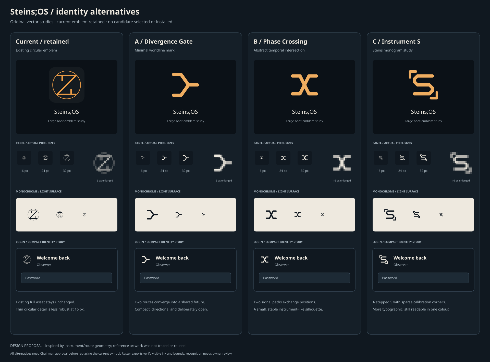

# Identity alternatives — V2 proposal

**Status:** three original vector candidates beside the current emblem. None is selected, approved or installed. The existing distro asset and V1 proposal remain unchanged.



## What the references contribute

The supplied images suggest a small, recognisable scientific/route symbol, a clear silhouette, monochrome usefulness and a relationship to the shell's instrument language. They are inspiration references. The phone screenshots, circle/hex route arrangement, franchise artwork and example product logos were not copied, traced or embedded in these assets.

All three alternatives were drawn from original SVG path geometry in `build_logos.py`. They use a 24×24 view box, a 2.2-unit principal stroke, rounded ends/joins and at least a small clear margin. The drawing deliberately avoids a circle-terminal/hex-base arrangement. The candidates work without a surrounding roundel or metallic treatment.

## The alternatives

| Mark | Intended meaning | Strength | Trade-off to assess |
|---|---|---|---|
| **Current / retained** | Existing circular instrument emblem and angular letterform | Familiar continuity with current boot/logo work; its full asset is preserved byte for byte | The thin circular detail becomes faint at 16 px. The colour/roundel contributes much of its current identity |
| **A / Divergence Gate** | Two routes converge into one shared future | Few components, open silhouette and robust directional reading; compact at panel size | It can read as a generic branch/arrow. Owner recognition needs testing before choosing it as a long-term primary mark |
| **B / Phase Crossing** | Two signal paths exchange positions | Stable instrument-like symmetry; works in one colour and can animate through a crossing sequence | It can read as an X/hourglass. Pairing with the wordmark may be needed until it becomes familiar |
| **C / Instrument S** | A stepped S with sparse calibration corners | Strongest direct Steins;OS letter association; related to technical measurement without relying on a circle | The small calibration corners need close review at 16 px. Removing them at tiny sizes would be an optical variant, not an automatically approved change |

**My recommendation for the next review:** compare C as a primary monogram direction and A as the clearest compact route direction, while keeping B as the restrained abstract alternative. This is a preference for exploration, not a selection. The current emblem remains the default everywhere until the Chairman approves a change.

## Practical studies supplied

`comparison-sheet.svg` / `.png` show each mark as:

- A large amber boot-emblem composition with the existing `Steins;OS` name.
- Actual-size monochrome **16 / 24 / 32-pixel** raster exports.
- A magnified 16-pixel raster so small-size anti-aliasing is visible.
- A reverse treatment on a warm light surface.
- A compact login identity study.

These are design mock-ups. They are not boot/login implementation screenshots or proof that any animation is integrated.

The current full asset is `current.svg`, copied unchanged from `config/includes.chroot/usr/share/icons/hicolor/scalable/apps/steins-os.svg`. `current-monochrome.svg` is an explicitly separate display study that removes the backing tile and makes the existing geometry monochrome; it is not a replacement source file. The three alternative SVGs are transparent with `currentColor`, so later approved UI integration can apply a single colour without filters or raster recolouring.

## Verification and remaining decisions

Executed:

```sh
python3 design/worldline-v2/identity/build_logos.py
/usr/bin/python3 design/worldline-v2/identity/check_logos.py
```

The script uses the already installed `steins-os-builder:trixie` container as a non-root `rsvg-convert` renderer, writes only this identity folder, parses every SVG as XML and verifies the retained current asset's exact bytes/SHA-256. `VALIDATION.json` records source/render hashes. `RASTER-CHECKS.json` records all twelve tiny raster dimensions, visible-ink counts and alpha bounds; each has nonempty ink and no clipped edges at the checked alpha threshold.

Visually inspected the full comparison sheet. The marks render at the requested sizes and the light/dark examples remain clear. Pixel/bounds checks are not user-recognition, screen-reader or whole-brand validation. Test the preferred direction as a real 24-pixel panel icon, a menu icon among others, a login mark and an animated boot symbol before selecting it.

No files outside `design/worldline-v2/identity/` were changed by this exploration. No package, theme, bootloader, desktop, VM or approved emblem was replaced.

## License and provenance

New SVG geometry, comparison layout and generator code are original Steins;OS contributor work, licensed MIT. The retained current emblem and its separately labelled monochrome study retain the existing repository artwork attribution/license (CC-BY-4.0, Steins;OS contributors). The supplied reference images were inspected only and are not redistributed in this identity package.
